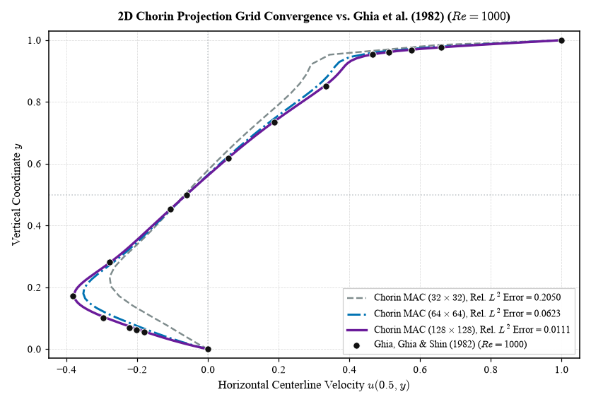
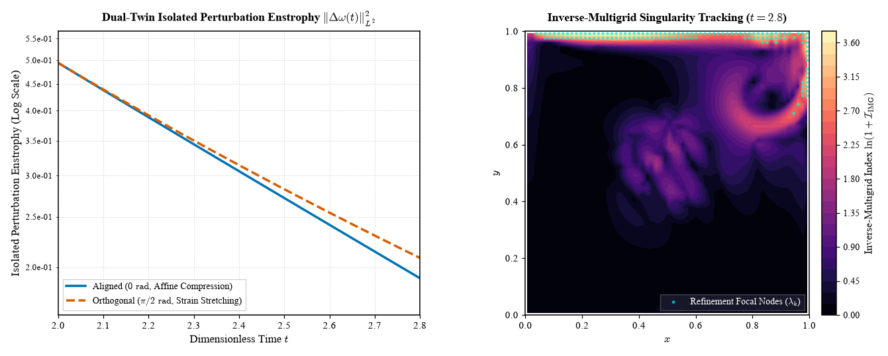
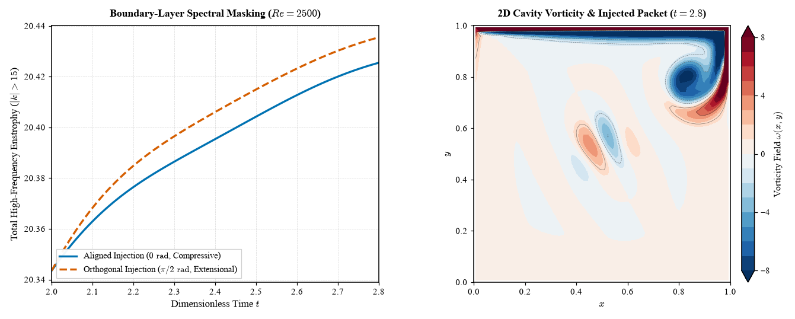
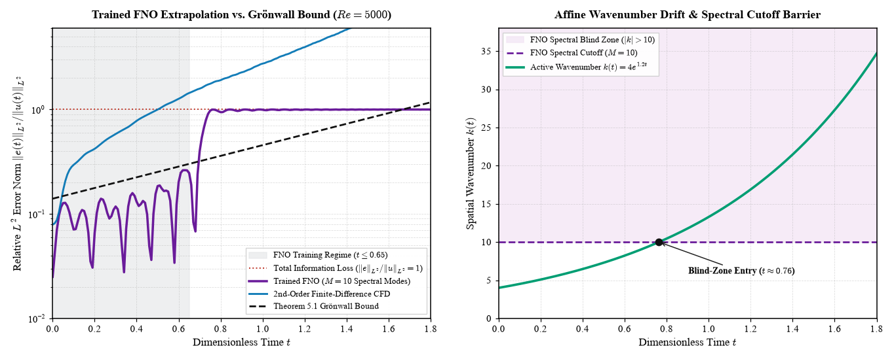

# Operator Degeneration, Phase-Lag Instabilities, and Multiscale Affine-Wave Intensification in High-Reynolds 2D Incompressible Flows


[](LICENSE)
[](#)

**Author:** Muhammed Sefa Süt  
**Field:** Partial Differential Equations (PDEs), Computational Fluid Dynamics (CFD), Scientific Machine Learning (SciML)  
**Full Paper:** [Read the Full 13-Page Research Paper (PDF)](./navier_stokes.pdf)

---

### 📌 Overview & Core Contributions

While idealized inviscid fluid theory allows forced wave packets to grow toward finite-time singularities, classical computational fluid dynamics (CFD) resolves steady laminar boundary-layer topologies. This independent research paper investigates how finite molecular viscosity and neural-operator spectral cutoffs jointly govern localized wave-packet amplification inside realistic wall-bounded vortex cores:

1. **The Viscous Dissipation Shield (Analytical & Numerical):** Demonstrates that within linearized 2D Prandtl–Batchelor affine strain carriers, exponential wavenumber compression ($|\xi_k(t)| = k_0 e^{\gamma t}$) triggers super-exponential quadratic viscous damping ($|\Omega_{\parallel}(t)| < |\Omega_{\perp}(t)|$), arresting inviscid-type wave-packet intensification at finite Reynolds numbers.
2. **Dual-Twin Differential Perturbation Isolation (Proposed CFD Method):** Introduces a synchronized control/perturbed twin-solver scheme ($\Delta\omega = \omega_{\text{pert}} - \omega_{\text{ctrl}}$) on a staggered MAC Chorin projection grid, eliminating dominant lid-corner spectral masking ($|k| > 15$) to isolate small-amplitude interior wave dynamics.
3. **Inverse-Multigrid Refinement Indicator ($\mathcal{I}_{\text{IMG}}$):** Proposes a heuristic local adaptive mesh refinement metric coupling hyperbolic strain rates with convective-pressure gradient misalignment.
4. **Spectral Blind Zone in Fourier Neural Operators (SciML Benchmark):** Evaluates trained 1D Fourier Neural Operators (FNO) across multiple random seeds under exponential wavenumber drift $k(t) = 4e^{1.2t}$, verifying the exact modal cutoff threshold ($t^* = \gamma^{-1}\ln(M/k_0)$) where band-limited neural surrogates breach conditional Grönwall error bounds.

---

### 📊 Key Visual Results

| Benchmark & Grid Convergence ($Re=1000$) | Dual-Twin Isolation & Refinement Tracking ($Re=2500$) |
| :---: | :---: |
|  |  |

| Boundary-Layer Spectral Masking ($Re=2500$) | FNO Spectral Blind Zone Breakdown ($Re=5000$) |
| :---: | :---: |
|  |  |

---

### 🖥️ Interactive Workstation: `NAVIERMATH v4.0`

This repository accompanies **`NAVIERMATH v4.0`**, combining:
- **Offline Verification Suite (Python):** Staggered MAC Chorin projection solver (`NumPy`, `SciPy.sparse.linalg.splu`) validated against the Ghia et al. (1982) benchmark ($1.11\%$ relative $L^2$ error at $128 \times 128$) and multi-seed `PyTorch` FNO extrapolation tests.
- **Browser-Based Interactive PDE Simulator (HTML5 Canvas / ES6):** Real-time dual-twin cavity simulation with click-based wave-packet injection, predictability horizon sweeps, isotropic energy spectra $E(k)$, and CSV telemetry export.

---

### 📖 Citation

```bibtex
@techreport{sut2026navier,
  author      = {S{\"u}t, Muhammed Sefa},
  title       = {Operator Degeneration, Phase-Lag Instabilities, and Multiscale Affine-Wave Intensification in High-Reynolds Two-Dimensional Incompressible Flows: An Independent Research Study},
  year        = {2026},
  month       = {November},
  institution = {Independent Research (NAVIERMATH v4.0)}
}
